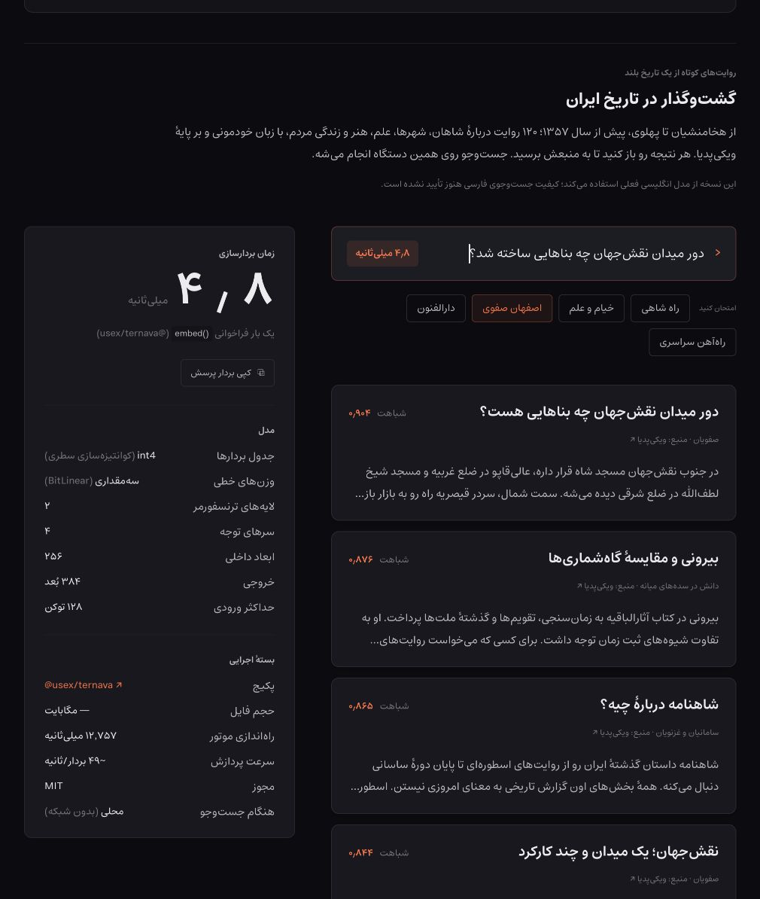

# Ternava — ترنوا

**Ternava is built on [Ternlight](https://github.com/soycaporal/ternlight) by
[Wenshu Tang (@soycaporal)](https://github.com/soycaporal). Thank you for the model,
Rust/WASM engine and training foundation.**

Compact, local **Persian/English text embeddings** for Bun, Node.js and browsers.
Turn text into vectors for semantic search, similarity and recommendations—without
an inference API or GPU. Model, tokenizer and engine ship together in WebAssembly.

[Live demo](https://ternava.usestrict.dev/) · [API reference](packages/mini/README.md) · [Quality report](docs/persian-pilot-compositional-results.md)

[](https://ternava.usestrict.dev/)

*Actual screenshot of the deployed history-search demo: 120 Persian passages,
RTL layout and Estedad typography. The demo still uses the earlier English model;
this familiar query illustrates the interface, not bilingual benchmark quality.*

## Install

Package name: **`@usex/ternava`**. Once published to npm:

```sh
bun add @usex/ternava
```

Until publication, [build the package](#build-verify-and-publish), then run
`bun add /absolute/path/to/ternava/dist/release/usex-ternava-0.1.1.tgz`
from your application directory. Both installation methods use the imports below.

## Quick start

Save as `search.mjs` and run `bun search.mjs`:

```js
import { embed, cosineSim, similar } from '@usex/ternava';

const vector = embed('سلام دنیا'); // Float32Array(384)
console.log(cosineSim(vector, embed('Hello world')));

const results = similar('forgot my password', [
  'Reset a forgotten password',
  'Track a delivery',
  'Change your address',
], { topK: 2 });
console.log(results); // [{ text, sim }, ...], highest similarity first
```

The Bun/Node entry initializes synchronously. No setup call or API key is needed.
Cache document vectors for repeated searches; rebuild them whenever the model or
tokenizer changes. Inputs longer than 128 tokens are truncated.

## Browser

Use the portable loader with explicit initialization:

```js
import init, { embed, similar } from '@usex/ternava/runtime';

await init();
const vector = embed('گشت‌وگذار در تاریخ ایران');
```

For a plain HTML app, copy `node_modules/@usex/ternava/pkg-web/` into your public
`ternava/` directory, serve it over HTTP and add this before your module script:

```html
<script type="importmap">
{ "imports": { "@usex/ternava/runtime": "./ternava/index.mjs" } }
</script>
```

Keep the generated files together: the loader fetches the adjacent WASM once;
subsequent inference runs locally. Bundlers must also copy that WASM asset.
See the [loading and API reference](packages/mini/README.md#portable-loader) for
custom asset loading, the synchronous bundler entry and raw `/web` exports.

## Persian / English pilot

| Property | Bilingual mini |
|---|---|
| Output | 384-dimensional, L2-normalized vectors |
| Tokenizer / input limit | 32,000 WordPiece tokens / 128 tokens |
| Parameters | 9,901,952 |
| Packed model weights | 5.17 MB |
| Browser WASM | 8.00 MB; about 5.35 MB gzipped |

**Experimental:** Persian retrieval is uneven; complex negation and arithmetic
remain unreliable. Recent candidates failed release gates and did not replace
the packaged reference. Runtime compatibility is tested separately from language
quality. Read the [measured results](docs/persian-pilot-compositional-results.md)
and [training protocol](docs/persian-pilot.md) before choosing it for your data.

## Build, verify, and publish

Development requires **Bun 1.4.3+**, Rust, wasm-pack and Python 3. Use Node.js
24.15+ for release tooling and compatibility tests. Prepare the packed bilingual
model using the [pilot protocol](docs/persian-pilot.md); weights and build outputs are not in Git.
Then, from the repository root:

```sh
bun install --frozen-lockfile
bun run build
bun run test
bun run verify:release
```

Verification packs and installs the real archive, checks Bun/Node exports and
prints a browser parity URL. The npm archive includes three WASM targets
(~16.24 MB compressed); a browser loads only one.

To release, commit your changes on `main`, authenticate with `npm login` using an
account with publish access to `@usex`, and run:

```sh
bun run release
# Preview without publishing or changing files:
bun run release --dry-run
```

[release-it](https://github.com/release-it/release-it) recommends the next version
from Conventional Commits, updates the package and Bun lockfile, builds and tests,
writes [CHANGELOG.md](packages/mini/CHANGELOG.md), publishes `@usex/ternava` with Bun,
and creates and pushes the release commit and tag. It uses your existing Git
identity/signing and npm authentication; confirm the version and release steps when prompted.
`packages/base` and the workspace root stay private and keep their own versions.
Build and verification alone never publish.

## Acknowledgments

Thanks to the upstream author credited above, [BitNet b1.58](https://arxiv.org/abs/2402.17764),
[bitlinear](https://github.com/schneiderkamplab/bitlinear),
[MiniLM](https://huggingface.co/sentence-transformers/all-MiniLM-L6-v2) and
[Estedad](https://github.com/aminabedi68/Estedad).

[Contributing](.github/CONTRIBUTING.md) · [Architecture](docs/architecture.md) ·
[MIT license and upstream attribution](packages/mini/LICENSE) ·
[Demo data and attribution](examples/docs-search/DATA-LICENSE.md)
