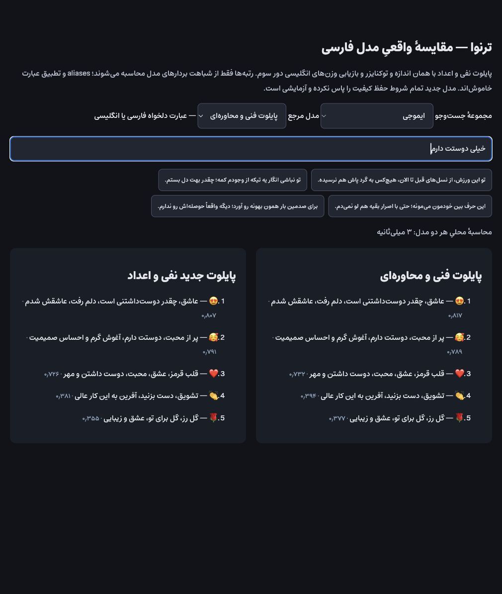
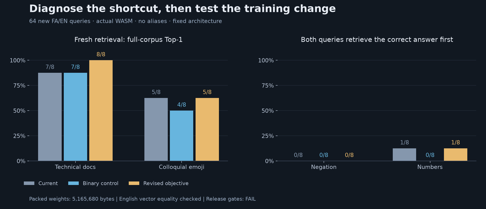

# Ternava — ترنوا

**Ternava is built on [Ternlight](https://github.com/soycaporal/ternlight) by
[Wenshu Tang (@soycaporal)](https://github.com/soycaporal). Thank you for the compact
embedding model, Rust/WASM engine, training pipeline, and open-source foundation
that made this Persian/English fork possible.** Original MIT attribution is
preserved in [LICENSE](LICENSE).

The name combines **Tern** with **نوا (navā, melody)**. The npm package is
**`@usex/ternava`**; its source lives in `packages/mini`.

<p align="center">
  
</p>

[](https://github.com/ali-master/ternava/actions/workflows/ci.yml)
[](LICENSE)

**Compact, on-device Persian/English semantic embeddings for Node.js, Bun, and
browsers.** Engine, model and tokenizer are embedded in WebAssembly. No inference
API or GPU is required. This remains an experimental model; see the measured
limitations below.

## Persian / English pilot

This fork develops a compact bilingual `mini`: **32,000 WordPiece tokens,
9,901,952 parameters, 384-dimensional embeddings and a 128-token input limit**.
Learned positions distinguish word order; ternary linear weights and int4
embeddings keep the packed weights at **5,165,680 bytes**. The tokenizer is
embedded in the WASM artifact and validated by SHA256 throughout the pipeline.

The Persian examples use RTL layout, the Estedad font and Persian corpora.
**A translated interface is not evidence of model understanding.** Pilot quality
is measured directly from packed WASM embeddings, using cosine similarity with
no aliases, query rewriting, numeric calculator or reranker.

The latest [compositional experiment](docs/persian-pilot-compositional-results.md)
starts with a [factorial diagnosis](docs/persian-pilot-compositional.md) **before
training**. Changing only the wording drops familiar negation pair accuracy from
144/144 to 57/144. Numeric pairs drop from 47/96 to 14/96 when adjacent answers
are added. The two-choice task rewarded operation/magnitude shortcuts;
unknown tokens and int4 quantization did not explain the main failure.

The revised training uses multiple candidate answers, equivalent query views,
three-valued negation labels and full-batch retrieval. A matched binary-loss
control uses the same data, initialization and 1,000-step budget. Shared weights
and non-Persian embedding rows remain frozen from the start, preserving English
without a post-training weight transplant.

**Current verdict: experimental — Persian negation and arithmetic are still not
solved.** On 64 new authored questions, the revised objective improves some
retrieval results, but fails reasoning and historical preservation gates. Neither
new candidate replaces the existing examples or local comparison model.

| Actual WASM metric | Current pilot | Binary control | Revised objective |
|---|---:|---:|---:|
| New technical questions Top-1 | 7/8 | 7/8 | 8/8 |
| New colloquial emoji Top-1 | 5/8 | 4/8 | 5/8 |
| New Persian negation, strict contrast | 7/16 | 8/16 | 8/16 |
| New Persian numbers, strict contrast | 9/16 | 7/16 | 9/16 |
| Negation pairs, both full-corpus Top-1 | 0/8 | 0/8 | 0/8 |
| Numeric pairs, both full-corpus Top-1 | 1/8 | 0/8 | 1/8 |
| External English STS Spearman | 0.769946 | 0.769946 | 0.769946 |
| External Persian STS Spearman | 0.635174 | 0.632080 | 0.631665 |
| Packed weights | 5,165,680 bytes | 5,165,680 bytes | 5,165,680 bytes |
| Complete WASM | 8,004,767 bytes | 8,004,767 bytes | 8,004,767 bytes |
| Gzipped WASM | 5,347,162 bytes | 5,347,217 bytes | 5,347,212 bytes |

Both new models produce **bit-identical English vectors on 2,533 external
sentences** and retain the three historical English ranking scores. However,
previous Persian docs/emoji sets and Persian STS have regressions. The unchanged
English model also solves no complete pairs in the new English logic sets;
this is not just a Persian vocabulary problem. The full report includes every
failed gate, the interrupted invalid-validation run, per-query failures and
training-data overlap limitations. These small authored sets are not a general
Persian benchmark.

<p align="center">
  
</p>

The screenshot at the top shows a known successful Persian love query in the
existing local comparison. It is not a fresh-test result or a screenshot of the
new candidate. The chart uses measured results: both opposite questions must
retrieve their correct answers first to count as a complete reasoning pair.
The upstream English release and live demo remain separate from these local
experiments. Renaming and packaging this pilot do not improve its measured quality. The [previous paired-reasoning report](docs/persian-pilot-reasoning-results.md)
is retained for comparison.

### Use the experimental artifact

The same local artifact now runs in **Node.js, Bun, and browsers**. Its portable
entry reads the adjacent WASM from disk in Node/Bun and fetches it over HTTP in a
browser. After initialization, inference is synchronous and local. No aliases,
remote API, or separate model download is involved:

```js
import init, { embed, cosineSim, similar } from './dist/pilot-fa-en-reasoning/d256/index.mjs';
await init();

const vector = embed('خیلی دوستت دارم'); // Float32Array(384)
console.log(cosineSim(vector, embed('عاشقتم')));
console.log(similar('خیلی دوستت دارم', [
  'عشق و علاقهٔ فراوان به تو دارم',
  'راهنمای نصب و راه‌اندازی نرم‌افزار',
  'The weather is sunny today',
], { topK: 2 }));
```

From the repository root, build the existing packed pilot and run the example:

```bash
BIN="$PWD/training/pack/out/pilot-fa-en-reasoning/model.bin" \
TOKENIZER="$PWD/training/pack/out/pilot-fa-en-reasoning/model.tokenizer.json" \
PKG=packages/mini TARGET=web WEB_OUT=dist/pilot-fa-en-reasoning \
bash scripts/build-engine.sh

node examples/node-bun/search.mjs 'خیلی دوستت دارم'
bun examples/node-bun/search.mjs 'خیلی دوستت دارم'
```

For browsers, use the same imports inside `<script type="module">` and serve the
build directory over HTTP. Keep `index.mjs`, `tern_engine.js`, and
`tern_engine_bg.wasm` together; paths resolve relative to the module, not the
working directory. CommonJS callers can use dynamic `import()` inside an async
function. `init()` is shared across concurrent callers, retries after a failed
load, and accepts a `URL`, WASM bytes, or a compiled `WebAssembly.Module` for custom
asset loading. Call it once before `embed`, `similar`, or `engineInfo`; early
inference throws `TernError` with code `NOT_INITIALIZED`.

The npm package exposes `@usex/ternava/runtime` with the same API and TypeScript
declarations. Its synchronous main entry and raw `/web` entry remain available.
The internal `base` workspace is private. These are **local changes, not an npm
publication**; the quality limitations above apply in every runtime.

Runtime checks (the Node run also writes the browser parity fixture):

```bash
node engine/tests/test_runtime.mjs dist/pilot-fa-en-reasoning/d256 dist/pilot-fa-en-reasoning/d256/runtime-parity.json
bun engine/tests/test_runtime.mjs dist/pilot-fa-en-reasoning/d256
# With the HTTP server below, open /engine/tests/runtime.html for browser parity.
```

### Run the local comparison

After training and building the artifacts described in the protocol:

```bash
python3 -m http.server 8877 --bind 127.0.0.1
# Open http://127.0.0.1:8877/eval/quality/native-preview.html
```

Select a reference model and corpus, then enter your own Persian or English
sentence. Everything runs locally. Generated checkpoints and `dist/` bundles
are local build outputs, not downloaded automatically by this page.

## Install and use Ternava

The public package name is `@usex/ternava`. Once a release has been published:

```bash
npm install @usex/ternava
# or: bun add @usex/ternava
```

```js
import { embed, cosineSim, similar } from '@usex/ternava';

const vector = embed('خیلی دوستت دارم'); // Float32Array(384)
console.log(cosineSim(vector, embed('عاشقتم')));
console.log(similar('reset my password', [
  'Reset a forgotten password', 'Track a delivery', 'Change your address',
], { topK: 2 }));
```

Node.js and Bun support both ESM and `require('@usex/ternava')`. Plain browsers
can serve `pkg-web/` and import its `index.mjs`, or map
`@usex/ternava/runtime` to that URL and call `await init()` once.
Bundlers use the browser entry (see [Bundling](#bundling)).
[Package API and loading details](packages/mini/README.md).

### Build, verify, and publish

From the repository root, with Rust, wasm-pack, Python 3 and the packed bilingual
pilot present (see the [pilot protocol](docs/persian-pilot.md)):

```bash
bun install --frozen-lockfile
bun run build
bun run test
bun run verify:release
# Install the tested local tarball before publication:
bun add ./dist/release/usex-ternava-0.1.1.tgz
```

The verifier installs the actual tarball in an isolated consumer and checks CJS,
ESM, `/web`, and `/runtime` in Node and Bun. It also exercises the browser entry
through Node's experimental WASM module integration. It prints the browser parity URL
for an HTTP-served checkout. A `prepack` check rejects missing exports/artifacts,
a wrong model vocabulary, or unequal model outputs across builds.
The npm archive is about 16.1 MB (24.1 MB unpacked), because it includes three
WASM target builds. A browser loads one 8,004,767-byte WASM, about 5.35 MB gzipped;
the model itself has not grown.

When ready, an account with publish rights to the `@usex` scope can publish the
**verified tarball** explicitly:

```bash
npm publish ./dist/release/usex-ternava-0.1.1.tgz --access public
```

No publication is performed by build or verification. `packages/base` is an
internal, private workspace and is not a second npm product. Old precomputed
English demo indexes must be rebuilt when changing to the bilingual model.

## Upstream architecture and English baselines

Distilled from [`all-MiniLM-L6`][minilm] with [BitNet b1.58][bitnet]-style quantization-aware training. Three design choices stack to fit an embedding model in a few MB:

- **Ternary weights** - every weight is `-1`, `0`, or `+1`; inference is adds and subtracts. Quality holds because the model trains as a ternary model from the start.
- **One bundle** - model + BERT tokenizer + engine in a single `.wasm`. No postinstall step, no runtime fetch.
- **SIMD inference engine** - hand-written Rust compiled to WASM SIMD; the add/subtract math rides CPU vector instructions.

[minilm]: https://huggingface.co/sentence-transformers/all-MiniLM-L6-v2
[bitnet]: https://arxiv.org/abs/2402.17764

The following are the existing upstream measurements for its shipped English int4 builds (M-series Mac, Node/V8), not results for the bilingual pilot:

|                                  | Upstream English mini | Upstream English base |
| -------------------------------- | -------------------------- | -------------------------- |
| **Wire size** (gzipped wasm)     | **5.0 MB**                 | **7.2 MB**                 |
| **Latency** (p50 per embed)      | **2.5 ms**                 | **5.1 ms**                 |
| Throughput (single-thread)       | ~400 emb/s                 | ~195 emb/s                 |
| Spearman vs MiniLM-L6 teacher    | 0.820                      | **0.844**                  |
| Retrieval (SciFact NDCG@10)      | 0.439                      | **0.465**                  |
| Architecture                     | 2-layer · d_model=256 · 4 heads | 2-layer · d_model=384 · 6 heads |
| Parameters                       | ~9.5M                      | ~15.4M                     |
| Output                           | 384-dim L2-normalized      | 384-dim L2-normalized      |
| Max input                        | 128 tokens (~95 words)     | 128 tokens (~95 words)     |
| Quantization                     | ternary weights · int4 embeddings | ternary weights · int4 embeddings |

## Why this exists

On-device embedding unlocks:

- **Search-as-you-type.** Results appear before the user finishes typing. Faster than any network round-trip can be.
- **Privacy-sensitive apps.** Queries and documents never leave the device - no data-handling agreements, no leak risk.
- **Offline-first apps.** Browser extensions, Obsidian plugins, desktop apps.
- **Edge-runtime apps.** Cloudflare Workers, Deno Deploy, Vercel Edge. Embeddings co-locate with your request handler - no separate inference service to call.
- **Edge devices and IoT hardware.** Raspberry Pi, single-board computers, industrial gateways, kiosks. Add/subtract math runs efficiently on ARM cores - no GPU or NPU required.
- **Static sites.** Jekyll, Hugo, Astro. Ship the model with the bundle; semantic search works without a backend.

---

## Repository layout

```
ternava/
├── packages/         npm package and internal workspace
│   ├── base/         @usex/ternava-base - private research tier (d384)
│   └── mini/         @usex/ternava - small/fast tier (d256)
├── engine/           Rust → Wasm inference engine
├── training/         Python distillation + QAT pipeline, packer
├── eval/             Engine quality + perf benchmarks
├── docs/             Design docs
├── models/           Model release registry pointers
├── scripts/          Build + release orchestration
└── .github/          CI workflows
```

Deeper reading: [project overview](docs/overview.md) · [architecture](docs/architecture.md) · [inference engine](docs/inference-engine.md) · [model internals](docs/model-internals.md) · [eval methodology](docs/eval-methodology.md).

Persian/English development: [32k bilingual mini pilot](docs/persian-pilot.md) — preparation,
training, tests and WASM comparisons. This is an experimental recipe, not a released Persian model.
The [native Persian continuation of round three](docs/persian-pilot-round3-native-results.md)
improves native QA retrieval while preserving English vectors and size, but still fails application and reasoning gates.
The [technical/colloquial pilot](docs/persian-pilot-domain-results.md) improves fresh docs
and emoji retrieval at unchanged model size; complex negation, numeric reasoning and
some retention gates still fail. Both remain experimental, with pure-model comparisons
available in `eval/quality/native-preview.html`.

### Workspace development

Use Bun 1.4.3 or newer to manage the monorepo; CI pins 1.4.3. Run
`bun install --frozen-lockfile` from the repository root. The single `bun.lock`
covers both packages and the emoji/Odyssey examples; Odyssey uses the local
`@usex/ternava` workspace. Use `bun run test` to run the package, release-guard,
workspace and example contracts. Node.js remains required for compatibility tests
and the WASM bundler prepack check. `bun run verify:release` creates the npm-compatible
tarball with `bun pm pack`, installs it with Bun and checks Node/Bun APIs.

### Moving a local checkout

Run training commands from the repository root and activate `.venv` there. New
training tokenizer metadata uses repository-relative paths. Older checkpoints with
absolute tokenizer paths under `training/distill/cache`, `training/distill/runs`,
or `engine/assets` also
load after a directory move; the tokenizer hash, vocabulary size and sequence
length must still match. Checkpoint weights and historical provenance are not
rewritten. External tokenizer files must remain at their recorded locations.

Python virtual environments contain absolute launcher paths. If you move an
existing checkout, recreate or repair both the launchers and activation scripts
before using it. Reopen the new folder in your editor and restart local servers
from that folder. Build scripts and the Node/Bun example resolve paths relative
to their own files.

## Bundling

The browser build ships WebAssembly as an ES-module asset (wasm-bindgen bundler target). Modern bundlers handle this natively; a couple need a one-line adjustment. Thanks to [@dmisdm](https://github.com/dmisdm) for [surfacing the Vite setup](https://github.com/soycaporal/ternlight/issues/3).

**Vite** - exclude the package from dependency pre-bundling so Vite's own pipeline instantiates the WASM:

```js
// vite.config.js
export default {
  optimizeDeps: {
    exclude: ['@usex/ternava']
  },
};
```

Requires **Vite ≥ 8.1**, which handles WASM ESM out of the box with no plugin ([release notes](https://vite.dev/blog/announcing-vite8-1)). On older Vite, also add [`vite-plugin-wasm`](https://www.npmjs.com/package/vite-plugin-wasm). Astro, SvelteKit, and Nuxt are Vite-based - same fix would apply.

**Next.js** - enable async WASM in the webpack config; the model runs client-side, so import it from a Client Component (or via `next/dynamic`):

```js
// next.config.js
module.exports = {
  webpack(config) {
    config.experiments = { ...config.experiments, asyncWebAssembly: true };
    return config;
  },
};
```

**webpack 5** - same experiment flag:

```js
// webpack.config.js
module.exports = {
  experiments: { asyncWebAssembly: true },
};
```

Node.js, Bun and browser paths are checked locally. Other runtimes and framework
bundlers need their own integration checks.

## Contributing

There's still tons of headroom for perf and quality improvements. Beyond stacked encoders, I'm curious about other modalities, specially generative use cases that fit the same tight constraints. JS, Rust, and ML contributors all welcome.

See [.github/CONTRIBUTING.md](.github/CONTRIBUTING.md).

## Acknowledgments

Ternava builds on these open-source efforts:

- **The upstream project credited at the top of this README**, by Wenshu Tang — the original model, engine, and training implementation.
  Its [English model artifacts](https://huggingface.co/wenshutang/ternlight) are separate from the bilingual Ternava pilot.

- **[BitNet b1.58](https://arxiv.org/abs/2402.17764)** (Ma et al., Microsoft Research, 2024) - the architectural research underlying ternary weight training.
- **[`bitlinear`](https://github.com/schneiderkamplab/bitlinear)** by [@schneiderkamplab](https://github.com/schneiderkamplab) - the reference PyTorch implementation of BitLinear. We use it directly during training (`bitlinear==2.4.6`) and the Rust inference engine mirrors its forward-pass math byte-for-byte.
- **[`sentence-transformers/all-MiniLM-L6-v2`](https://huggingface.co/sentence-transformers/all-MiniLM-L6-v2)** - the original English teacher model.
- **[Estedad](https://github.com/aminabedi68/Estedad)** - the Persian typeface used by the RTL examples; its font license is included with the assets.

The bilingual training data, multilingual supervision and experiment-specific
limitations are documented in the [pilot protocol](docs/persian-pilot.md) and
[continuation reports](docs/persian-pilot-reasoning-results.md).

The Rust engine in [`engine/src/kernels.rs`](engine/src/kernels.rs) is an independent reimplementation of `bitlinear`'s `BitLinear.forward()` for the WASM target; parity tests guard against drift.

## License

MIT - see [LICENSE](LICENSE).

---

<sub>Persian preview: actual local WASM inference. Quality chart: reproducible from the pilot evaluation JSON with <code>eval/quality/reasoning-report.py --plot-only</code>. The original bird photograph remains in <code>docs/assets/banner.jpeg</code>; credit: <a href="https://macaulaylibrary.org/asset/637450290">Macaulay Library</a>, Cornell Lab of Ornithology.</sub>

---

<p align="center"><em>In memory of Alex Movsessian - who held software to the highest standard, and treated everyone around him with kindness.</em></p>
